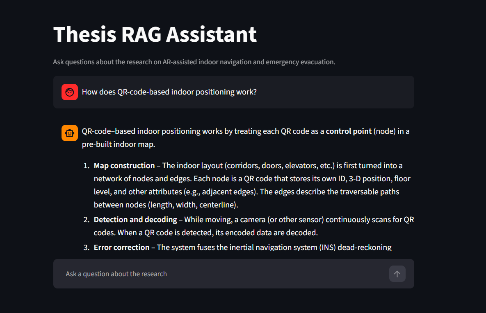

# Thesis RAG Assistant

A retrieval-augmented question-answering system over the research literature on AR-assisted indoor navigation and emergency evacuation. Ask a question in plain English and get an answer grounded in the source papers, with page-level citations.

**Live demo:** https://thesis-rag-assistant.streamlit.app/



Built as a portfolio project alongside my M.Sc. thesis on AR-assisted indoor navigation. The public demo runs over the published, open-access papers that underpin that thesis, so the questions and answers stay in a domain I know well.

The pipeline is ordinary RAG. The part worth reading is the evaluation harness built to measure it, and what that measurement overturned.

## What it does

- Answers natural-language questions using hybrid retrieval — semantic _and_ lexical — over a corpus of research papers.
- Grounds every answer in the retrieved text and cites the source file and page.
- Says "I don't have that information" when the answer isn't in the documents, instead of inventing one.
- Offers suggested starter questions so a first-time visitor knows what to ask.

## How it works

**Indexing (once):** each PDF is loaded, split into ~1000-character overlapping chunks, embedded into 384-dimensional vectors with a local sentence-transformers model, and stored in a FAISS index alongside its source and page metadata. The same chunks are tokenised into a BM25 index.

**Querying (per question):** the question is run through both retrievers in parallel — dense nearest-neighbour search over FAISS, and BM25 lexical scoring — and the two ranked lists are combined with Reciprocal Rank Fusion. The fused top-k chunks are inserted into a prompt instructing the model to answer from the provided context and cite pages, and a Groq-hosted LLM writes the grounded answer.

```
PDFs ──► chunking ──► embeddings (MiniLM) ──► FAISS index
                 └──► tokenising         ──► BM25 index

query ──┬──► dense retrieval ──┐
        └──► BM25 retrieval  ──┴──► Reciprocal Rank Fusion ──► top-k chunks
                                                                    │
                                                     grounded prompt ──► Groq LLM ──► cited answer
```

## Tech stack

| Layer             | Choice                                                 |
| ----------------- | ------------------------------------------------------ |
| Embeddings        | sentence-transformers `all-MiniLM-L6-v2` (local, free) |
| Vector store      | FAISS (`IndexFlatIP`, exact cosine search)             |
| Lexical retrieval | BM25 via `rank_bm25`                                   |
| Fusion            | Reciprocal Rank Fusion (k=60, candidate pool 20)       |
| Generation        | Groq API (`openai/gpt-oss-20b`, temperature 0.2)       |
| Evaluation judge  | Groq API (`openai/gpt-oss-120b`)                       |
| Interface         | Streamlit                                              |
| Hosting           | Streamlit Community Cloud                              |

Retrieval lives in two interchangeable modules exposing the same `retrieve` / `answer` interface — `rag.py` (dense only) and `hybrid.py` (dense + BM25 + RRF) — so configurations can be compared without touching the deployed app.

## Evaluation

A 15-question gold set (`eval/gold_set.json`), hand-written from the source PDFs, with a deliberate mix:

| Type         | Count | Tests                                             |
| ------------ | ----- | ------------------------------------------------- |
| `factual`    | 7     | Single-passage retrieval and grounding            |
| `conceptual` | 4     | Synthesis rather than copying                     |
| `multi_hop`  | 2     | Pulling from two papers at once                   |
| `negative`   | 2     | Graceful refusal — the corpus cannot answer these |

Scoring is a hand-rolled LLM-as-judge harness. RAGAS is the production equivalent; this was built from scratch to keep the metric computation inspectable, and the judge is a _larger_ model than the generator to limit self-preference bias.

| Metric              | What it compares           | How it is computed                                                                   |
| ------------------- | -------------------------- | ------------------------------------------------------------------------------------ |
| Faithfulness        | answer ↔ retrieved context | Answer decomposed into atomic claims; score is the fraction supported by the context |
| Answer relevance    | answer ↔ question          | Rubric score 0 / 0.5 / 1 on how fully the question is addressed                      |
| Context precision   | chunks ↔ question          | Per-chunk relevance verdict; score is relevant / k                                   |
| Refusal correctness | behaviour ↔ `answerable`   | Did it refuse an unanswerable question, and answer an answerable one                 |

Faithfulness and relevance are averaged over answerable questions only — a correct refusal scores zero on both by construction, so including the negatives would penalise correct behaviour.

Execution and scoring are separate steps. `run_eval.py` freezes raw output to JSON; `score_eval.py` grades that frozen file. Judge prompts can therefore be iterated without re-running the pipeline, and every number traces back to a stored run.

## Results

| Metric            | Dense, k=4 | Hybrid, k=4 | Hybrid, k=8 + synthesis prompt |
| ----------------- | ---------- | ----------- | ------------------------------ |
| Faithfulness      | 0.67       | 0.73        | **0.92**                       |
| Answer relevance  | 0.77       | 0.92        | **1.00**                       |
| Context precision | 0.33       | **0.50**    | 0.38                           |
| Refusal accuracy  | 0.80       | 0.87        | **0.93**                       |

<sub>Final run: `eval/results/scored_hybrid_k8_newprompt_20261023T121008Z.json`. One question (q10) returned an empty response after a transient API rate-limit error, so it is excluded and the answerable-question means are over 12 rather than 13.</sub>

Context precision is lower at k=8 because it is a ratio over k: the absolute number of relevant chunks rises, but the denominator rises faster. It diagnoses retrieval efficiency; it does not measure answer quality.

## What the evaluation changed

**Retrieval was the bottleneck, not generation.** On the dense baseline, three of thirteen answerable questions were falsely refused. Excluding those three, faithfulness was already 0.87 and relevance 1.00 — the model answered well whenever it was handed the right passages. That reframed the whole effort as a retrieval problem.

**Hybrid retrieval fixed two of the three.** Questions turning on exact technical strings — "final drift error", "NavARNode" — were invisible to embeddings, which compress rare tokens into a general neighbourhood of meaning. BM25 found them. In practice RRF acted less as a union of two candidate sets and more as a re-ranker over a shared pool: the chunks dense retrieval needed were often present but ordered at ranks 5 and 6, outside the top-k window.

**The last failure was a prompt, not a retriever.** The remaining multi-hop question asked how two papers _differ_. No single chunk states a difference; it has to be constructed by comparison. The original prompt said _answer using only the context; if the answer is not in the context, say you don't have that information_ — so the model refused, correctly following instructions.

**The two fixes only work together.** A synthesis-permitting prompt changed nothing at k=4, because the second paper's chunk sat at rank 6 and was never retrieved. A larger k changed little under the restrictive prompt. Together, faithfulness went 0.72 → 0.92 and relevance to 1.00. _The value of retrieving more depends on whether the prompt permits using it._

**A cross-encoder reranker was planned and cancelled.** Reranking reorders candidates you already have. Measurement showed the failing question had all its relevant chunks retrieved and still refused — so better ordering could not have helped. The evidence cancelled the work.

## Design decisions

- **RAG over a bare LLM** — grounding answers in retrieved source text is what keeps the model from hallucinating on a domain-specific corpus.
- **Local embeddings** — running the embedding model on-device keeps the pipeline free and means no document text is sent to a third party during indexing.
- **Hybrid over pure vector search** — embeddings blur rare technical tokens; BM25 does not. Measured, not assumed: see Results.
- **Reciprocal Rank Fusion over weighted score blending** — cosine similarity and BM25 scores live on incompatible scales, so normalising and tuning a blend weight invites overfitting on 15 questions. RRF discards magnitudes and fuses on rank alone, with one conventional constant.
- **Separate run and score steps** — judge prompts get iterated far more often than the pipeline does; freezing raw output means re-scoring is cheap and every published number is traceable.
- **A larger judge than the generator** — grading output with the model that produced it invites self-preference bias.
- **Citations and graceful failure** — the system reports which pages an answer came from and declines when retrieval is weak, because a confidently wrong answer is worse than no answer.
- **Public open-access corpus** — the deployed demo uses only CC-BY / gold-open-access papers so the repository can be shared freely; my own thesis is kept private and never committed.

## Limitations

- **Conflation on out-of-scope questions.** Asked what accuracy the corpus reports for AR guidance _while driving_, the system answers with a real, correctly cited visual-inertial odometry drift figure from a vehicular test in one of the papers. Every fact is true and grounded; it is still the wrong answer, because pose-tracking drift is not guidance accuracy. Faithfulness and citation checks both pass it — only the refusal metric catches it. A prompt narrow enough to prevent this would likely cause over-refusal, so it is documented rather than patched.
- **Small gold set.** Fifteen questions. Differences under roughly 0.08 on the answerable-question means are within one question's worth of movement and should not be read as real.
- **LLM-as-judge.** Scores come from a model, not human annotation. The judge is larger than the generator to reduce self-preference, but it is not independent ground truth.
- **Context precision is k-dependent** and cannot be compared across configurations with different k without accounting for the denominator.
- **Single corpus, single domain.** Six papers on one topic. Nothing here establishes that the configuration generalises.
- **Generation quality is bounded by the free-tier model.** The model is a single configurable constant and can be swapped.

## Run it locally

```bash
git clone https://github.com/karthik-dixith/thesis-rag-assistant.git
cd thesis-rag-assistant
python -m venv .venv
.venv\Scripts\Activate.ps1        # Windows
pip install -r requirements.txt
```

Add a `.env` file with a free Groq API key:

```
GROQ_API_KEY=your_key_here
```

Put PDFs in `data/`, build the index, and run:

```bash
python build_index.py
streamlit run app.py
```

## Reproduce the evaluation

```bash
# capture a run (raw answers + retrieved chunks)
python eval/run_eval.py --retriever hybrid --k 8 --tag my_run

# score that frozen run
python eval/score_eval.py --run run_my_run_<timestamp>.json
```

| Flag                        | Purpose                                             |
| --------------------------- | --------------------------------------------------- |
| `--retriever dense\|hybrid` | Which retrieval module to use                       |
| `--k`                       | Chunks passed to both retrieval and generation      |
| `--tag`                     | Label for the run file                              |
| `--judge-model`             | Override the scoring model                          |
| `--resume`                  | Continue a scoring run that stopped on a rate limit |

Run files and scored files are kept in `eval/results/`, so every number in this README traces back to the run that produced it.

## Project structure

```
thesis-rag-assistant/
├── ingest.py           # load PDFs, split into chunks
├── build_index.py      # embed chunks, build and save the FAISS index
├── rag.py              # dense retrieval, prompt construction, cited generation
├── hybrid.py           # dense + BM25 retrieval fused with RRF
├── app.py              # Streamlit chat interface
├── eval/
│   ├── gold_set.json   # 15 hand-written questions with reference answers
│   ├── run_eval.py     # run the gold set, freeze raw output
│   ├── score_eval.py   # LLM-as-judge scoring over a frozen run
│   └── results/        # every run and score file
├── data/               # source PDFs
├── index/              # saved FAISS index and chunk metadata
└── requirements.txt
```

## Corpus and attribution

The demo is built over these open-access papers:

- Qiu, Mostafavi & Kalantari (2025), _Use of augmented reality in human wayfinding: A systematic review_ — Springer, open access.
- Valizadeh et al. (2024), _Indoor AR pedestrian navigation for emergency evacuation based on BIM and GIS_ — Heliyon, gold open access.
- Putra et al. (2025), _Adaptive AR navigation: real-time mapping using node placement and marker localization_ — MDPI Information, open access.
- Liu & Zhang (2023), _Indoor positioning and navigation based on QR code map_ — ISPRS Archives, CC BY.
- Kim et al. (2022), _A benchmark comparison of four off-the-shelf proprietary visual–inertial odometry systems_ — MDPI Sensors, open access.
- Zhu et al. (2025), _Semantics-based connectivity graph for indoor pathfinding powered by IFC-Graph_ — Cambridge Apollo, CC BY.

## Next steps

- Query decomposition for multi-hop questions, so a comparison question retrieves per-sub-question rather than relying on a single fused ranking.
- A larger gold set, sized so that differences of this magnitude are statistically meaningful.
- Human annotation on a subset, to calibrate how far the LLM judge can be trusted.
